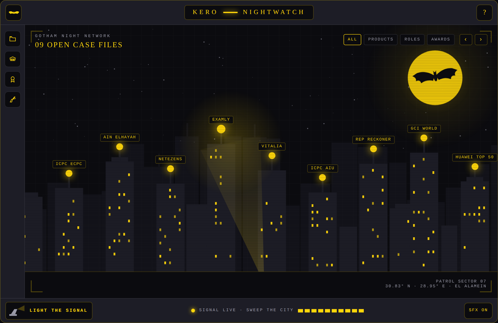
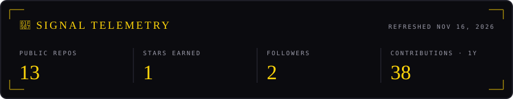
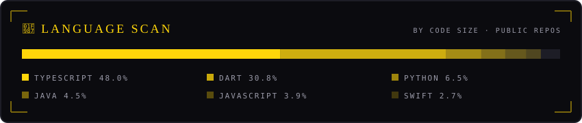
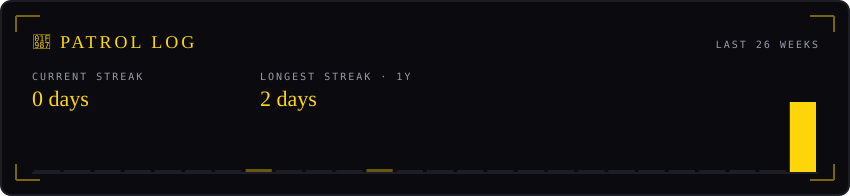

<p align="center">
  
</p>

<p align="center">
  <strong>AI ENGINEER & FULL-STACK DEVELOPER</strong> · <sub>COMPUTER VISION · LLM APPS & RAG · PRODUCTION ML · SAAS</sub>
</p>

<p align="center">
  
  
  
</p>

> I build AI products end to end, from the model to production: **94%+** retinal-disease accuracy on Huawei ModelArts, **3** production ML pipelines shipped with a **12-member** AI team, and an algorithms program for **100+** students.

## 🦇 KERO NIGHTWATCH

<p align="center">
  <a href="https://kerolosnader69.github.io/KerolosNader69/" title="Enter Kero Nightwatch">
    
  </a>
</p>

<p align="center">
  <a href="https://kerolosnader69.github.io/KerolosNader69/"></a>
  
</p>

<p align="center"><sub>My portfolio as a city at night. Steer the searchlight, and every lit rooftop opens a case file.</sub></p>

---

## 🦇 CASE LOG

```text
IDENTITY ........ Kerollos Nader Mounir
CLASS ........... AI Engineer · Full-Stack Developer
SPECIALTY ....... Computer Vision · LLMs & RAG · Production ML · SaaS
EDUCATION ....... B.Sc. Computer Science & Engineering — Alamein International University, 2027
```

I lead AI work at a startup, train competitive programmers at my university, and run my own AI product. I like problems where a model has to survive contact with real users.

---

## 🦇 FEATURED CASES

| Case | Problem → Result |
|:--|:--|
| **[Ain ElHayah](https://github.com/KerolosNader69/Ain_ElHayah)**<br><sub>AI healthcare platform</sub><br><sub>`Flutter` `Python` `CNNs` `RAG` `Huawei Cloud`</sub><br><sub>[open dossier ↗](https://kerolosnader69.github.io/KerolosNader69/?case=ain)</sub> | Eye-disease screening needs specialists who are hard to reach.<br>→ **94%+** retinal fundus accuracy · **Top 50 of 1,200+** at Huawei Developer Competition 2025 |
| **[Examly](https://examly.site)**<br><sub>AI oral-exam SaaS · Founder</sub><br><sub>`Next.js` `Supabase` `Deepgram` `Gemini`</sub><br><sub>[open dossier ↗](https://kerolosnader69.github.io/KerolosNader69/?case=examly)</sub> | Teachers can't grade spoken exams at scale.<br>→ Live at **[examly.site](https://examly.site)**: grades by meaning, not keywords, in English & Arabic (Egyptian dialect) |
| **[Vitalia Academy](https://vitalia.academy)**<br><sub>Full online academy · Built end to end</sub><br><sub>`Next.js` `Supabase` `Cloudflare`</sub><br><sub>[open dossier ↗](https://kerolosnader69.github.io/KerolosNader69/?case=vitalia)</sub> | Instructors and learners need one place to teach, learn and certify.<br>→ Live at **[vitalia.academy](https://vitalia.academy)**: a bilingual academy with student, instructor, admin & super-admin dashboards and an AI assistant |
| **Rep Reckoner**<br><sub>AI fitness app</sub><br><sub>`Flutter` `FastAPI` `Supabase` `Gemini`</sub><br><sub>[open dossier ↗](https://kerolosnader69.github.io/KerolosNader69/?case=rep)</sub> | Generic workout plans ignore the person doing them.<br>→ **Launched on Google Play**: personalised plans from each user's physiological data |
<!-- TODO: add the Google Play link for Rep Reckoner once confirmed -->

<details>
<summary><b>Inside each case</b></summary>
<br>

**Ain ElHayah**: three computer-vision models (retinal disease detection, colour-blindness screening, diagnostics), CNNs deployed on Huawei ModelArts, a voice-enabled RAG medical chatbot, and a doctor-booking system.

**Examly**: multi-tenant SaaS with a branded subdomain per teacher, a role-based admin panel, tab-switch detection for exam integrity, and an AI pipeline (Deepgram speech-to-text + Gemini) that grades spoken, MCQ and written answers. In production on a custom domain with SSL, RLS policies, service-role API isolation and 3-layer admin authentication.

**Vitalia Academy**: a complete bilingual online academy. Instructors publish courses, students learn and earn verifiable certificates, admins and a super admin run the platform, and an AI assistant helps learners along the way.

**Rep Reckoner**: a Gemini-powered recommendation engine that builds workout plans from user data, with a FastAPI backend and real-time sync through Supabase.

</details>

<details>
<summary><b>Case archive: earlier builds</b></summary>
<br>

| Project | What it is | Stack |
|:--|:--|:--|
| [pacman](https://github.com/KerolosNader69/pacman) | Pac-Man simulation where Pac-Man and a chasing ghost path-find with A* | Python · Pygame |
| [Transportation System](https://github.com/KerolosNader69/Transportation-management-system-gui) | Trip management with separate employee & passenger dashboards | Java · Swing |
| [Restaurant System](https://github.com/KerolosNader69/Restaurant-Management-System-master) | Reservations on a BST, waitlist on a priority queue | Java |
| [Digital Clock](https://github.com/KerolosNader69/Digital-clock) | Clock built from logic ICs and 7-segment displays, two hardware versions | Logic design · Proteus |

</details>

---

## 🦇 PATROL HISTORY

<table>
  <thead>
    <tr><th>WHEN</th><th>POST</th><th>DETAILS</th></tr>
  </thead>
  <tbody>
    <tr>
      <td>Jan 2025 – Present</td>
      <td><b>Netezens</b><br><sub>AI Team Lead · AI solutions startup · Egypt</sub></td>
      <td>Leads a 12-member AI team; delivered 3 production ML pipelines in cybersecurity, including a 91%-accuracy image classifier.</td>
    </tr>
    <tr>
      <td>Apr 2025 – Present</td>
      <td><b>ICPC Community, AIU</b><br><sub>Technical Lead & Algorithm Instructor</sub></td>
      <td>Built an 8+ topic curriculum adopted by 100+ members; runs weekly algorithm sessions.</td>
    </tr>
  </tbody>
</table>

<details>
<summary><b>Mission log</b></summary>
<br>

**Netezens · AI Team Lead**
- Lead a 12-member AI team building intelligent features for a student activity and mentorship platform, with weekly code reviews and sprint planning.
- Delivered 3 production ML pipelines in the cybersecurity domain, including an image classifier at 91% accuracy.
- Defined the technical architecture for the AI modules and integrated the models into the core product.

**ICPC Community, AIU · Technical Lead & Algorithm Instructor**
- Built a competitive-programming curriculum covering 8+ topics (graph theory, dynamic programming, string algorithms), adopted as the main training framework for 100+ members.
- Run weekly algorithm sessions for 100+ students.

</details>

---

## 🦇 TOOLKIT

<p align="center">
  <a href="https://skillicons.dev"></a>
</p>

```text
[LANGUAGES]   Python · C++ · Dart · JavaScript · SQL · Java · Bash
[AI / ML]     PyTorch · TensorFlow · Keras · CNNs · Transformers · NLP · RAG · LLMs · Computer Vision
[DATA]        PostgreSQL · MySQL · MongoDB · Redis · Supabase
[CLOUD]       Huawei Cloud · AWS · Docker · GitHub Actions · Linux
```

---

## 🦇 SIGNAL TELEMETRY

<p align="center">
  
</p>
<p align="center">
  
</p>
<p align="center">
  
</p>

---

## 🦇 RECOGNITION

| YEAR | RECOGNITION | ISSUER |
|:--|:--|:--|
| 2026 | Honored Participant, GCI World (25,000+ applicants, 120+ countries) | University of Tokyo, Matsuo-Iwasawa Lab |
| 2025 | Top 50 Finalist of 1,200+ (North Africa), project: Ain ElHayah | Huawei Developer Competition |
| 2024 | Regional Contestant, solved 9 of 13 problems | ICPC ECPC |

<details>
<summary><b>Certifications</b></summary>
<br>

| Certification | Issuer |
|:--|:--|
| Building Multi-Agent Systems | Microsoft & Coursera |
| HCIA-AI | Huawei |
| CS50's Introduction to AI with Python | Harvard University |
| Neural Networks and Deep Learning | DeepLearning.AI |
| Artificial Intelligence Training | Impact (IAO accredited) |

</details>

---

## 🦇 CURRENT MISSION

```text
[~] Leading the AI team at Netezens
[~] Training 100+ competitive programmers at ICPC AIU
[~] Running Examly in production
[ ] B.Sc. Computer Science & Engineering — June 2027
```

---

## 🦇 BAT-SIGNAL

<p align="center">
  <a href="mailto:kfparody809@gmail.com"></a>
  <a href="https://www.linkedin.com/in/kerollos-nader"></a>
</p>

<p align="center"><sub><code>LAST UPDATED · NOVEMBER 2026</code></sub></p>
